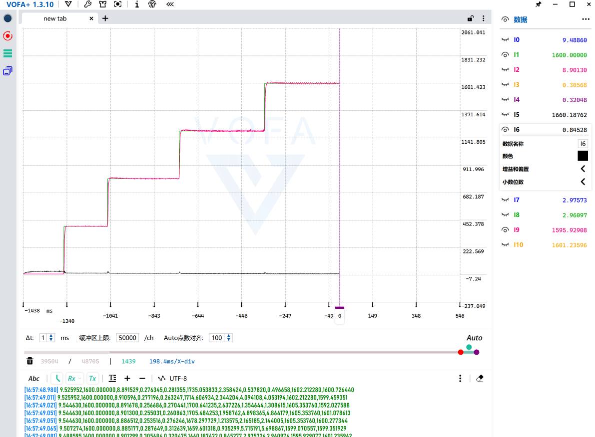
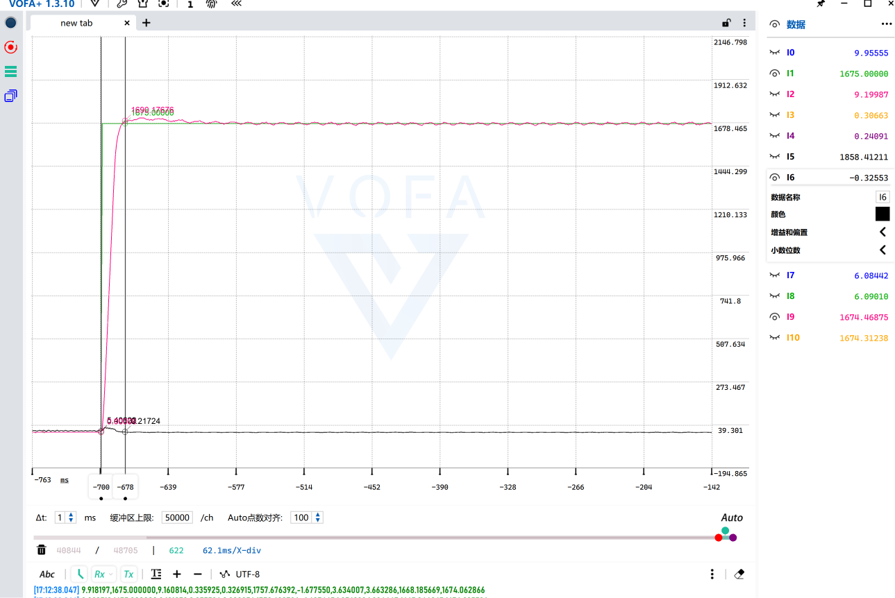
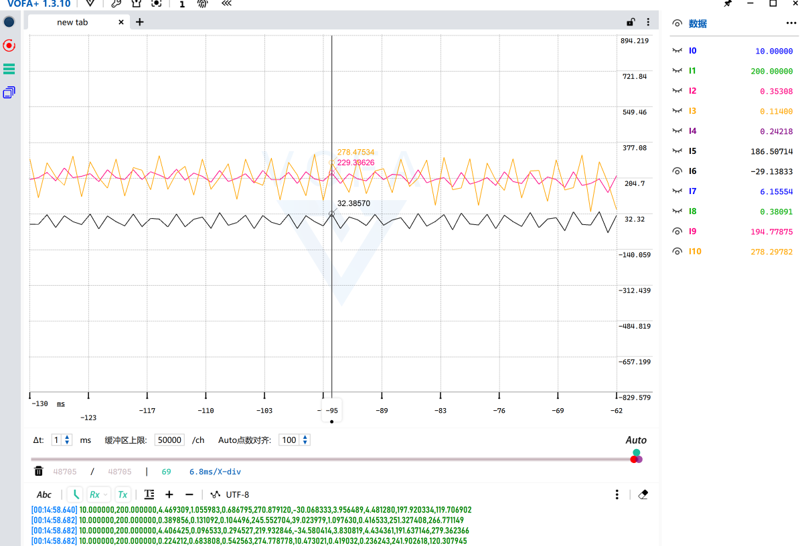
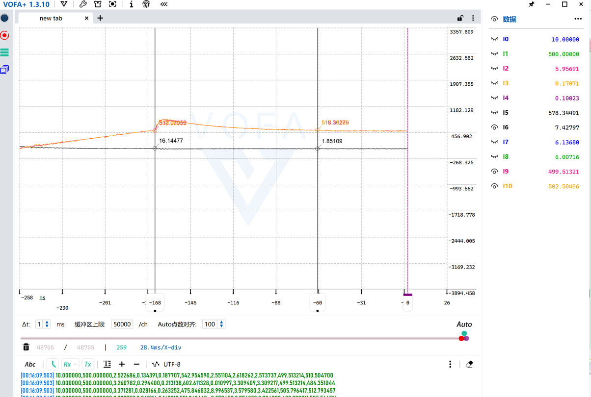

# 基于STM32的PMSM永磁同步电机FOC矢量控制系统

## 项目简介
基于STM32主控实现永磁同步电机（PMSM, Permanent Magnet Synchronous Motor）磁场定向控制（FOC, Field Oriented Control），采用增量式编码器作为位置/速度反馈，完成**电流环-速度环-位置环三闭环串级控制**；在此基础上扩展**滑模观测器（SMO, Sliding Mode Observer）+ 锁相环（PLL, Phase-Locked Loop）无传感器方案**，配合开环I/F启动，实现中高速无感运行。在调试过程中独立定位并解决了ADC采样偏差、硬阶跃启动超调、无感增益闭环耦合等实际工程问题，所有性能指标均为空载实测结果。

## 硬件平台
- 主控：STM32F4系列MCU
- 电机：表贴式永磁同步电机（SPMSM, Surface-mounted PMSM），4对极
- 位置反馈：增量式编码器，1000线，硬件四倍频计数（4000脉冲/转）
- 调制方式：SVPWM空间矢量调制（Space Vector Pulse Width Modulation）
- 电流采样：三电阻下桥臂采样
- 上位机：VOFA+ 波形调试，串口通信（115200波特率）

## 核心性能指标汇总
| 工况 | 实测指标 |
|------|----------|
| 0→3000rpm 空载速度阶跃（优化后） | 上升时间约40ms，超调量6.5%，稳定时间约150ms |
| 500rpm 低速空载稳态（ADC校准后） | 转速波动±6rpm，稳态静差<0.5% |
| 0→360° 空载位置阶跃 | 定位时间约170ms，无明显超调，稳态定位精度优于1° |
| 中高速无感稳态（1600rad/s≈3820rpm） | 稳态角度误差 0~2° |
| 0→1675rad/s（≈4000rpm）无感观测阶跃 | 角度误差峰值约24°，收敛至±1°约22ms |
| 低速无感边界（200rad/s≈477rpm） | 角度误差峰峰值约32°，需I/F启动覆盖 |

---

## 详细调试过程与实测波形

### 一、问题1：硬阶跃启动超调严重
#### 问题现象
初始版本直接给定0→1256rad/s（对应3000rpm）硬阶跃指令，转速峰值达到1734rad/s，超调量约38%，且伴随多次振荡，运行平稳性差。

#### 排查与优化
- 尝试直接调整速度环PI参数，发现对超调改善非常有限，分析核心原因为：大误差下积分快速累积导致**积分饱和**，同时硬阶跃指令本身存在冲击。
- 最终加入**速度指令阶梯斜坡函数**，限制每个控制周期指令的最大变化量，从给定输入端避免突变冲击，配合积分逻辑优化，解决启动超调问题。

### 二、优化后速度环阶跃响应
#### 实测结果
加入斜坡函数后，0→3000rpm空载阶跃响应：
- 10%→90%上升时间约40ms
- 超调量6.5%（峰值1337rad/s）
- 进入±5%误差带稳定时间约150ms
- 过渡过程仅1~2次小幅波动，快速收敛无持续振荡。

上升时间实测光标（146rad/s→1139rad/s，间隔39ms）：

### 三、问题2：低速稳态速度呈正弦规律波动
#### 问题现象
给定-200rad/s（对应约500rpm反转）稳态时，实际转速在-185~-211rad/s之间呈明显周期性正弦波动，无法稳定。

#### 排查与解决
- 经过交叉测试，定位原因为电流采样偏差：官方手册给出的固定1.25 ADC校准参数与实际硬件存在误差，导致电流检测存在周期性偏置，最终反映为转速波动。
- 改为**上电自动执行ADC校准**，获取当前硬件实际校准值，消除电流采样偏置。

校准后正弦波动完全消失，转速稳定在-197~-203rad/s，稳态波动±6rpm，达到预期精度：

### 四、位置环定位响应
#### 实现方案
在速度环外环增加位置环P控制器，构成位置-速度-电流三闭环串级架构；依赖前序优化后的速度环性能，仅比例环节即可实现平稳定位，采用过阻尼调校，优先保证定位无超调。

#### 实测结果
0→360°（单圈）空载阶跃定位：
- 定位时间约170ms
- 峰值359.0006°，无明显超调
- 稳态定位精度优于1°

---

### 五、无感控制：SMO滑模观测器 + PLL锁相环

#### 方案设计
针对无位置传感器场景，在静止坐标系（α-β轴）下构建滑模观测器：以实测电流、电压为输入，通过滑模开关项强迫观测电流跟踪真实电流，开关项经低通滤波后等效出反电动势，进而提取转子位置与速度。
- 采用饱和函数 `sat()` 替代符号函数 `sign()`，削弱滑模开关带来的高频抖振；
- 不直接对反电动势 `atan2` 求角（对噪声敏感、速度微分抖动大），而是引入PLL锁相环：将反电动势矢量投影鉴相，经PI调节器、积分得到平滑的角度与速度，把角度估计转化为闭环锁相问题。

**观测误差的定义与单位（重要）**：
- 角度误差 = 编码器实测角度 − SMO/PLL估算角度，并将误差归一化到 [-π, π]，避免跨 2π 跳变；
- 角度误差再乘以 57.2958（=180/π）转换为**度（°）**；
- 速度量未乘系数，单位为**电角速度（rad/s）**；机械转速(rpm) = 电角速度 × 60/(2π×极对数)。

#### 自适应增益的尝试与问题分析
固定滑模增益存在固有矛盾：为覆盖额定转速需取较大 k（实测 k=10），但低速时增益过大、抖振严重。曾尝试自适应增益 `k = ω·Flux·1.15`（按当前反电动势峰值动态匹配），实测能改善低速抖振、加快收敛。
但分析发现：若直接用PLL输出速度 `speed_pll` 作为 k 的计算源，会形成 `k → 观测器 → PLL → speed_pll → k` 的闭环耦合，构成正反馈环路，在参数摄动下产生极限环振荡，可靠性不足。工程方案优先保证稳定可靠，故最终放弃该自适应方案，采用固定 k=10，低速段改用开环I/F启动覆盖。

#### 稳态误差-转速特性
在「编码器闭环、SMO并行观测」方式下，给定 400/800/1200/1600 rad/s（电角速度）阶梯转速，实测稳态角度误差：

| 电角速度（rad/s） | 对应机械转速（rpm） | 稳态角度误差（°） |
|------------------|--------------------|------------------|
| 400  | ≈955  | 6 ~ 8 |
| 800  | ≈1910 | 5 ~ 6 |
| 1200 | ≈2865 | 3 ~ 4 |
| 1600 | ≈3820 | 0 ~ 2 |

该规律验证了反电动势型SMO的物理特性：转速越高，反电动势幅值越大、信噪比越高，观测角度误差越小；阶梯切换瞬间的误差峰值也随转速升高而减小（约 21°→18°→15°）。中高速下固定 k 与自适应方案性能接近，差异主要体现在低速段。

#### 动态阶跃性能
0→1675 rad/s（对应额定约4000rpm机械转速）空载阶跃，实测：
- 角度误差峰值约 24°；
- 误差收敛至 ±1° 误差带时间约 22ms。

#### 低速边界验证
将电机置于SMO无感闭环、200 rad/s（约477rpm）低速稳态运行，实测角度误差峰峰值约 32°，波动剧烈，无法实现高精度稳定运行。这是反电动势型SMO的固有物理局限：反电动势幅值与转速成正比，低速下反电动势极低、信噪比差，并非参数调试所能解决。

### 六、I/F无感启动与平滑切换
为覆盖低速盲区，实现开环I/F启动：
- **开环拖动阶段**：给定 id=0、固定幅值 iq（实测2A），电角度匀速自增（加速度400 rad/s²），拖动电机匀加速到 500 rad/s（约1194rpm）；
- **锁频判据**：当 PLL估算速度与开环速度之差 < 15 rad/s 并连续稳定 50ms，判定观测器已稳定跟踪，执行切换；
- **无缝衔接**：切换瞬间速度给定对齐当前转速、速度环积分预载当前 iq（实测2A），并将开环与估算角度的初始相位差 `trans_offset` 归一化到 [-π, π]，随后用 20ms（200个控制周期）线性衰减该相位差，最终平滑过渡到PLL角度。

实测切换瞬间转速存在约3%的小幅突变（约 502→518 rad/s），随后快速收敛至给定，切换完成无失步。

---

## 工程优化总结
1. **电流采样校准**：放弃固定校准参数，改为上电自动ADC校准，消除硬件偏置导致的周期性转速波动。
2. **指令斜坡+积分饱和抑制**：针对硬阶跃启动超调，仅调整PI参数效果有限，通过增加速度指令阶梯斜坡，从指令源头限制冲击，将超调从38%优化至6.5%。
3. **表贴式MTPA策略**：针对表贴式电机Ld=Lq特性，采用id=0控制，即表贴式电机的最大转矩电流比（MTPA, Maximum Torque Per Ampere）控制，单位电流输出转矩最大化。
4. **串级带宽匹配**：位置环带宽设置低于速度环，采用过阻尼调校，保证定位无超调、无内外环振荡。
5. **无感观测器设计**：SMO采用饱和函数替代符号函数削弱抖振，并用PLL锁相环替代直接求角，输出平滑角度/速度，1600rad/s中高速稳态角度误差0~2°。
6. **增益闭环耦合问题**：分析出自适应增益以PLL速度为源会形成正反馈极限环，为可靠性改用固定增益，低速段以I/F开环启动覆盖。
7. **无感平滑切换**：采用锁频判据+速度/积分预载+20ms相位差线性衰减，实现开环到无感闭环的无失步切换。

## 功能特性
- Clarke / Park 坐标变换、反Park变换
- SVPWM空间矢量调制
- 增量编码器四倍频位置计数、M法测速
- 上电自动ADC校准
- 带积分限幅的PI控制器
- 速度指令阶梯斜坡限制
- 电流环、速度环、位置环三闭环串级控制
- 表贴式电机id=0 MTPA控制
- SMO滑模观测器（饱和函数+低通提取反电动势）
- PLL锁相环（矢量投影鉴相+PI闭环锁相）
- I/F开环无感启动
- 锁频判据 + 速度/积分预载 + 相位差线性衰减的平滑切换
