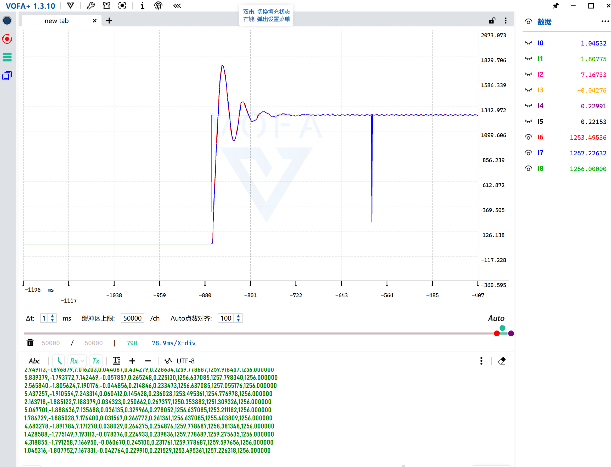
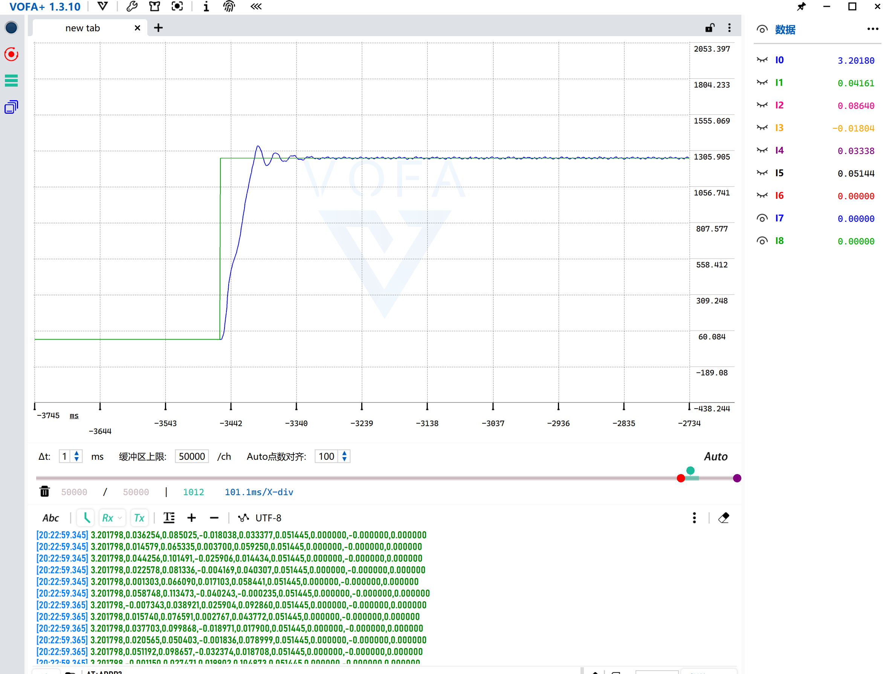
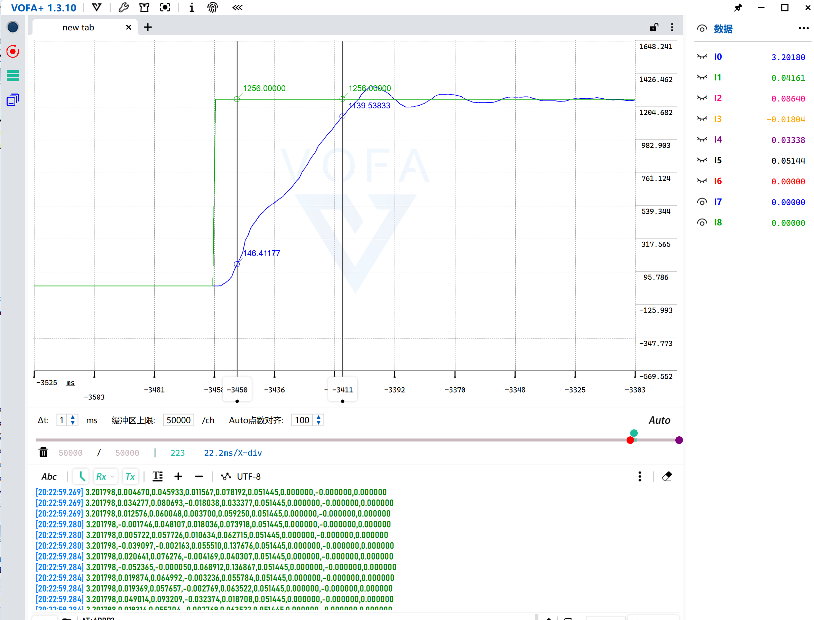
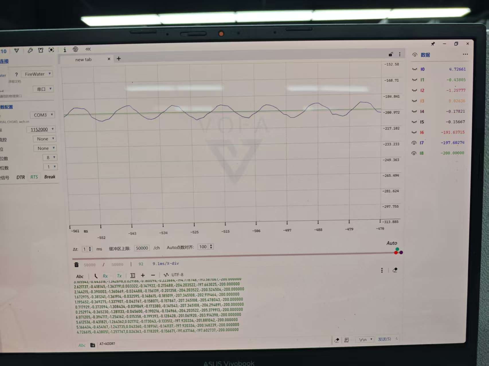
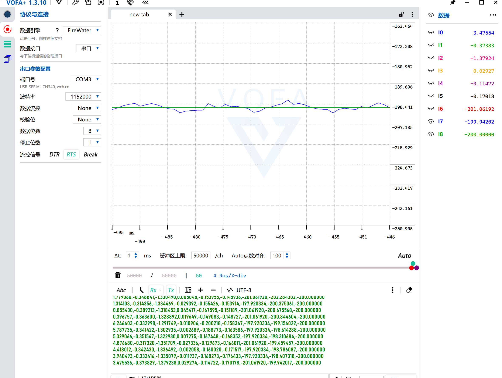
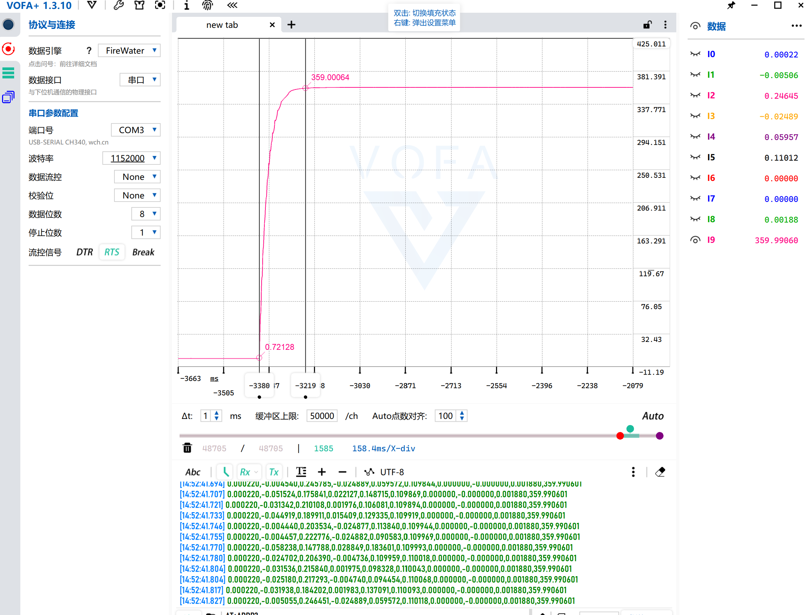

# 基于STM32的PMSM永磁同步电机FOC矢量控制系统

## 项目简介
基于STM32主控实现永磁同步电机（PMSM, Permanent Magnet Synchronous Motor）磁场定向控制（FOC, Field Oriented Control），采用增量式编码器作为位置/速度反馈，完成**电流环-速度环-位置环三闭环串级控制**；在调试过程中独立定位并解决了ADC采样偏差、硬阶跃启动超调等实际工程问题，所有性能指标均为空载实测结果。

## 硬件平台
- 主控：STM32F4系列MCU
- 电机：表贴式永磁同步电机（SPMSM, Surface-mounted PMSM），4对极
- 位置反馈：增量式编码器，1000线，硬件四倍频计数（4000脉冲/转）
- 调制方式：SVPWM空间矢量调制（Space Vector Pulse Width Modulation）
- 电流采样：三电阻下桥臂采样
- 上位机：VOFA+ 波形调试，串口通信（115200波特率）

## 核心性能指标汇总
| 工况 | 实测指标 |
|------|----------|
| 0→3000rpm 空载速度阶跃（优化后） | 上升时间约40ms，超调量6.5%，稳定时间约150ms |
| 500rpm 低速空载稳态（ADC校准后） | 转速波动±6rpm，稳态静差<0.5% |
| 0→360° 空载位置阶跃 | 定位时间约170ms，无明显超调，稳态定位精度优于1° |

---

## 详细调试过程与实测波形

### 一、问题1：硬阶跃启动超调严重
#### 问题现象
初始版本直接给定0→1256rad/s（对应3000rpm）硬阶跃指令，转速峰值达到1734rad/s，超调量约38%，且伴随多次振荡，运行平稳性差。

#### 排查与优化
- 尝试直接调整速度环PI参数，发现对超调改善非常有限，分析核心原因为：大误差下积分快速累积导致**积分饱和**，同时硬阶跃指令本身存在冲击。
- 最终加入**速度指令阶梯斜坡函数**，限制每个控制周期指令的最大变化量，从给定输入端避免突变冲击，配合积分逻辑优化，解决启动超调问题。

### 二、优化后速度环阶跃响应
#### 实测结果
加入斜坡函数后，0→3000rpm空载阶跃响应：
- 10%→90%上升时间约40ms
- 超调量6.5%（峰值1337rad/s）
- 进入±5%误差带稳定时间约150ms
- 过渡过程仅1~2次小幅波动，快速收敛无持续振荡。

上升时间实测光标（146rad/s→1139rad/s，间隔39ms）：

### 三、问题2：低速稳态速度呈正弦规律波动
#### 问题现象
给定-200rad/s（对应约500rpm反转）稳态时，实际转速在-185~-211rad/s之间呈明显周期性正弦波动，无法稳定。

#### 排查与解决
- 经过交叉测试，定位原因为电流采样偏差：官方手册给出的固定1.25 ADC校准参数与实际硬件存在误差，导致电流检测存在周期性偏置，最终反映为转速波动。
- 改为**上电自动执行ADC校准**，获取当前硬件实际校准值，消除电流采样偏置。

校准后正弦波动完全消失，转速稳定在-197~-203rad/s，稳态波动±6rpm，达到预期精度：

### 四、位置环定位响应
#### 实现方案
在速度环外环增加位置环P控制器，构成位置-速度-电流三闭环串级架构；依赖前序优化后的速度环性能，仅比例环节即可实现平稳定位，采用过阻尼调校，优先保证定位无超调。

#### 实测结果
0→360°（单圈）空载阶跃定位：
- 定位时间约170ms
- 峰值359.0006°，无明显超调
- 稳态定位精度优于1°

---

## 工程优化总结
1. **电流采样校准**：放弃固定校准参数，改为上电自动ADC校准，消除硬件偏置导致的周期性转速波动。
2. **指令斜坡+积分饱和抑制**：针对硬阶跃启动超调，仅调整PI参数效果有限，通过增加速度指令阶梯斜坡，从指令源头限制冲击，将超调从38%优化至6.5%。
3. **表贴式MTPA策略**：针对表贴式电机Ld=Lq特性，采用id=0控制，即表贴式电机的最大转矩电流比（MTPA, Maximum Torque Per Ampere）控制，单位电流输出转矩最大化。
4. **串级带宽匹配**：位置环带宽设置低于速度环，采用过阻尼调校，保证定位无超调、无内外环振荡。

## 功能特性
- Clarke / Park 坐标变换、反Park变换
- SVPWM空间矢量调制
- 增量编码器四倍频位置计数、M法测速
- 上电自动ADC校准
- 带积分限幅的PI控制器
- 速度指令阶梯斜坡限制
- 电流环、速度环、位置环三闭环串级控制
- 表贴式电机id=0 MTPA控制
